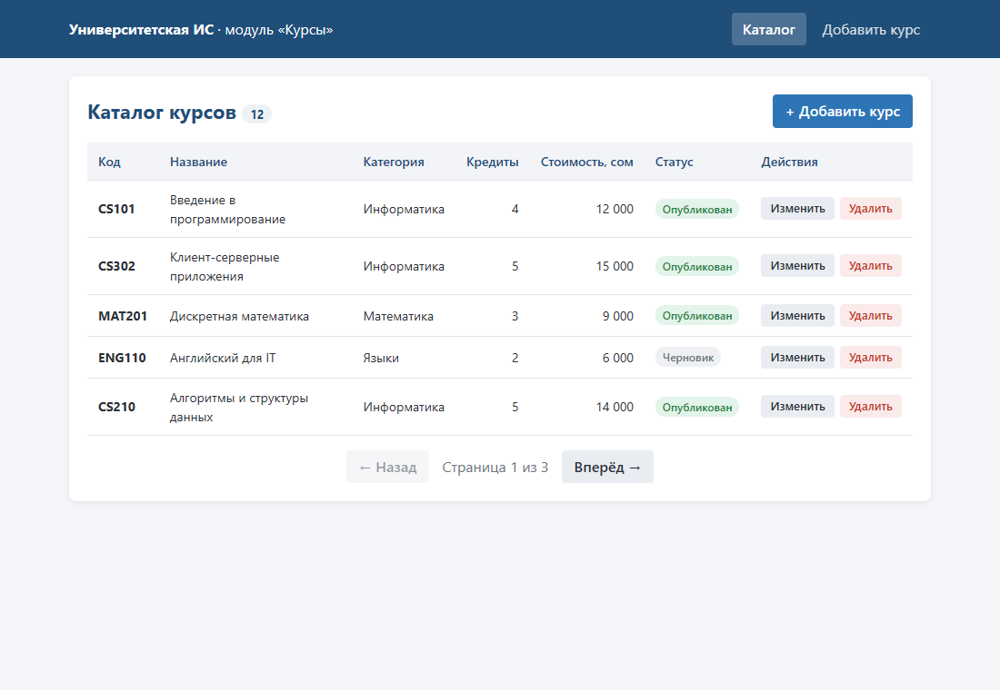
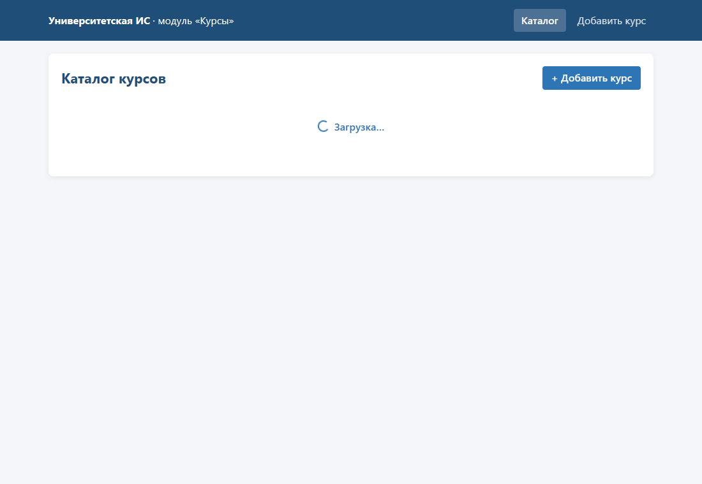
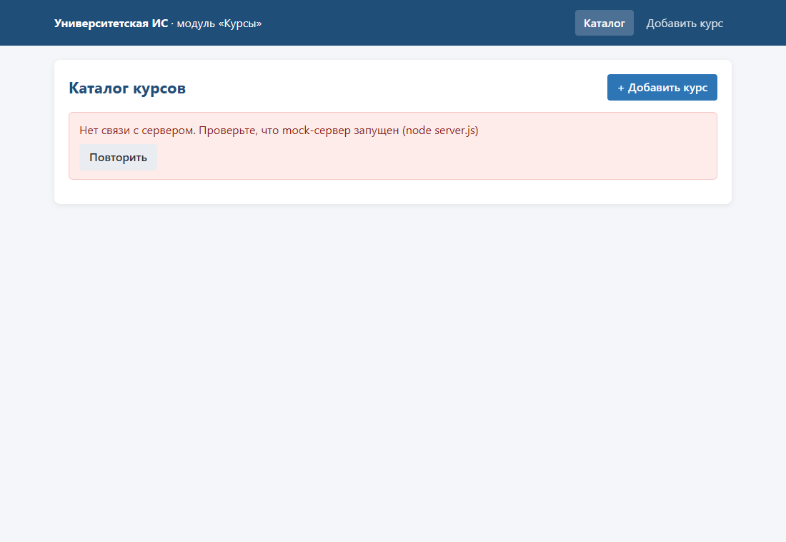
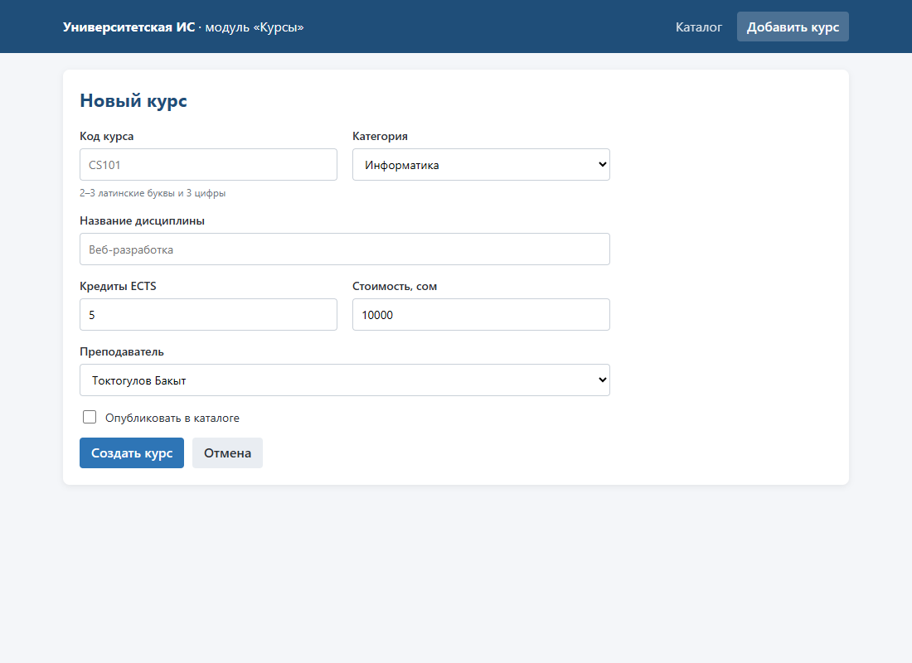
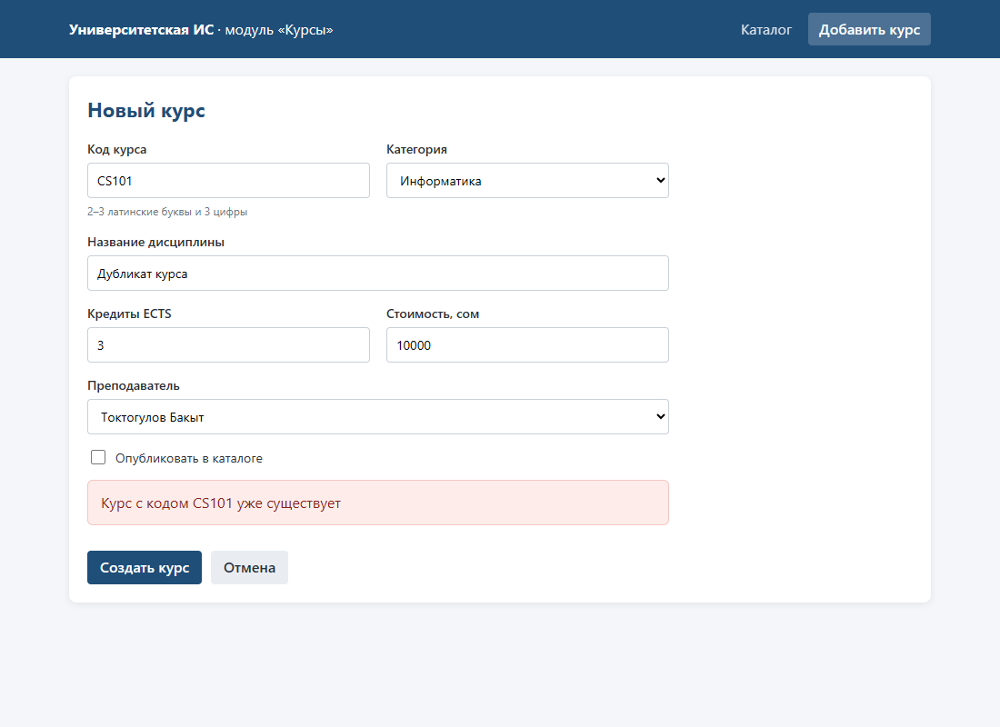
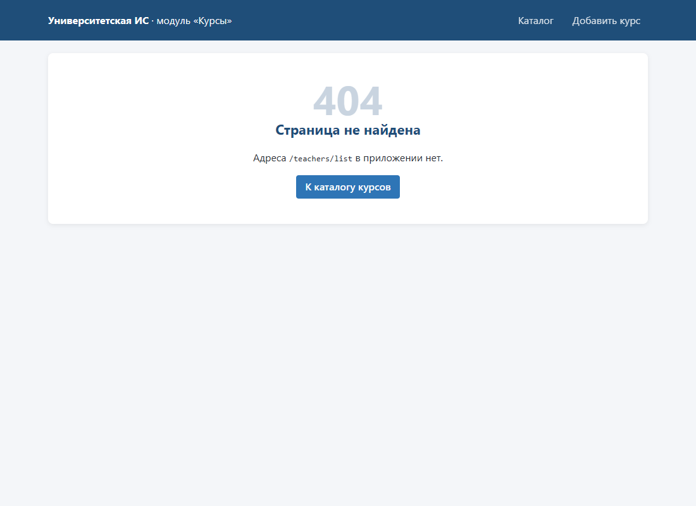

# lab5-react-client — React-клиент «Университетской ИС»

Лабораторная работа №5 по дисциплине «Разработка клиент-серверных приложений».

**Предметная область** (из лабораторной №1, типы из лабораторной №4): каталог учебных курсов университета.
Курс — код (`CS101`), название, кредиты ECTS, категория, преподаватель, стоимость для контрактных студентов в сомах
и признак публикации. Клиент позволяет просматривать каталог постранично, добавлять, изменять и удалять курсы.

Стек: Vite 8 + React 19 + TypeScript 7 (strict) + React Router 7; учебный mock-сервер на Node.js без зависимостей.

## Запуск

Нужен Node.js 20.19+ или 22.12+ (проверено на 24.22).

**Проще всего (Windows):** двойной щелчок по `start.bat` в корне проекта. Он при первом запуске выполнит `npm install`,
откроет два окна (сервер и клиент) и браузер. Остановка — закрыть эти два окна.

**Вручную** — сервер и клиент это два отдельных процесса, два окна терминала:

```bash
# окно 1 — mock-сервер (http://localhost:3000)
cd mock-server
node server.js

# окно 2 — клиент (http://localhost:5173)
cd client
npm install
npm run dev
```

Открывайте клиент именно по адресу **http://localhost:5173** — сервер разрешает CORS только для этого origin.

### Если не запускается

| Сообщение | Причина и решение |
|---|---|
| `npm : Невозможно загрузить файл ...\npm.ps1, так как выполнение сценариев отключено` | ограничение PowerShell. Запускайте `start.bat`, либо пишите `npm.cmd run dev`, либо один раз выполните `Set-ExecutionPolicy -Scope CurrentUser RemoteSigned` |
| `npm error Missing script: "dev"` / `Could not read package.json` | команда запущена не в той папке: `npm run dev` выполняется в `client`, а не в корне проекта |
| `'vite' не является внутренней или внешней командой` | не установлены зависимости (например, проект распакован из zip): `cd client`, `npm install` |
| `Port 5173 is already in use` | клиент уже запущен в другом окне — закройте его (порт закреплён намеренно, см. ниже) |
| `EADDRINUSE :::3000` | сервер уже запущен в другом окне — закройте его |
| в браузере «Нет связи с сервером» | не запущен mock-сервер (`node server.js` в `mock-server`) или страница открыта не по `localhost:5173` |

Порт клиента закреплён (`strictPort` в `vite.config.ts`): иначе при занятом 5173 Vite молча переходит на 5174,
а сервер не разрешает запросы с этого адреса — в браузере была бы ошибка «Нет связи с сервером».

Другие команды клиента: `npm run build` — проверка типов и сборка; `npm run preview` — просмотр сборки.
Параметры сервера: `PORT`, `ALLOWED_ORIGIN`, `DELAY_MS` (задержка для проверки загрузки), `DB_FILE`.
Адрес API клиента — `client/src/config.ts` (или переменная `VITE_API_URL`).

## Страницы и маршруты

| Адрес | Страница |
|---|---|
| `/` | перенаправление на `/courses` |
| `/courses` | каталог: таблица, пагинация по 5 записей, удаление с подтверждением, ссылки «Изменить» |
| `/courses/new` | форма создания курса |
| `/courses/:id/edit` | форма изменения; для несуществующего или некорректного id — сообщение |
| любой другой | страница 404 |

## API (mock-сервер)

`GET /api/courses?page=&limit=` → `{ items, total, page, limit }`; `GET/PUT/DELETE /api/courses/:id`; `POST /api/courses`.
В `server.js` из методички добавлена проверка коллекции `courses`: обязательные поля и допустимые значения → `422`,
повторный код курса → `409`.

## Структура клиента

```
client/src/
├── main.tsx                 # точка входа, BrowserRouter
├── App.tsx                  # шапка и маршруты
├── config.ts                # адрес API
├── types.ts                 # Course, CourseInput, Paginated<T>, Result<T>, категории
├── guards.ts                # isRecord, isCourse, isPaginatedCourses
├── api.ts                   # request<T> → Result<T>; list/get/create/update/delete
├── hooks/useCourses.ts      # загрузка страницы с AbortController
├── components/CourseTable.tsx
├── components/CourseForm.tsx
└── pages/                   # CoursesPage, CourseFormPages (New/Edit), NotFoundPage
```

Журнал проблем и работы с ИИ: [docs/problems.md](docs/problems.md).

## Скриншоты

| | |
|---|---|
| Каталог  | Загрузка  |
| Сервер недоступен  | Новый курс  |
| Ошибка сервера 409  | Страница 404  |

Данные на скриншотах вымышленные.
